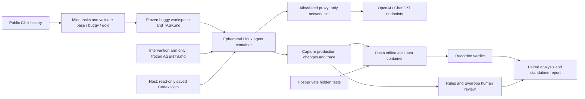

# Agent Readiness Probe

An agent can read repository guidance and still run commands in the wrong order. Passing existing tests can also leave a stated requirement unverified. A readiness assessment needs evidence about what the agent did, which checks passed, and whether a preparation change helped.

This probe reconstructs real historical bug-fix tasks from [Click](https://github.com/pallets/click), runs a pinned coding agent in isolated Linux containers, evaluates its production changes against a frozen oracle, and compares a setup-guidance file with baseline attempts. The result is a report with outcomes, uncertainty, trace diagnostics and human-reviewed failures.

**Completed pilot:** 12 accepted tasks, four development and eight confirmation, two arms, two attempts per arm per task. All 48 scored outcomes are recorded. Codex CLI 0.153.1 used **gpt-5.6-luna / low**. The primary confirmation result is **inconclusive**. This is a small research prototype with a measured preparation experiment, not a universal readiness score.

## Quickstart: view the recorded report

Download or clone this repository, then open [reports/click_readiness.html](reports/click_readiness.html) in your browser. It is one self-contained HTML file with no remote assets. On GitHub, download the file first to see the rendered report.

Alternatively, from the repository root with Python 3.11+:

```shell
python -B -m http.server 8765 --bind 127.0.0.1 --directory reports
```

Open **http://127.0.0.1:8765/click_readiness.html**. Stop the local server with Ctrl+C. This preview needs no packages, Docker, Codex login or model calls.

Read [five findings](docs/findings.md), the [two-minute demo script](docs/demo_script.md), and the [M4 diagnostic definitions](docs/m4_results.md). The [M5 summary](results/m5_summary.json) and [attempt diagnostics](results/m4_diagnostics.json) contain the recorded measurements. Public evidence includes selected agent command/output excerpts and test names, while raw traces, hidden tests and gold patches remain private.

Private evidence, including hidden tests, gold patches, and raw traces, is withheld from this public copy. Six historical evidence links in `docs/m1_results.md` and `docs/m3_human_review.md` will not resolve here; the link checker reports those exact links as known unavailable dependencies.

## How the probe works



The miner freezes the historical base, task statement and regression oracle after validity checks. The agent image derives from the validated evaluator environment and adds Node and Codex CLI. Its workspace contains buggy source with public tests, TASK.md and, only in the intervention arm, the same AGENTS.md file. Both arms receive the same sentence asking the agent to read it if present.

Hidden tests, gold patches, private artifacts, original Git history and the Docker socket are never mounted into the agent. Its internal Docker network has a single exit through an allowlisted proxy. Probes blocked GitHub, PyPI and direct-IP egress while allowing the required Codex endpoint. Web search was disabled. Saved login credentials are visible inside the ephemeral agent container, an accepted limitation. The container is deleted after each attempt, and hidden tests are injected only into a fresh evaluator with network disabled.

Eight M3 baseline attempts count as confirmation baseline repeat 1 and were retained without reruns. Forty remaining slots were randomized within task blocks, seed **20261002**. [The frozen M5 plan](docs/m5_plan.md) records the exact configuration, treatment hash and order.

## Real results

Success is the primary outcome. Agent wall time is the prespecified key secondary. Tool calls, tokens and failed public test commands are diagnostics.

| Outcome | Baseline | Setup-v1 intervention | Difference / uncertainty |
|---|---:|---:|---|
| Confirmation success, primary | 12/16, 75% | 12/16, 75% | 0 pp, selected 95% interval [-96.032, +96.032] pp, inconclusive |
| Confirmation mean agent wall time | 54.334s | 56.996s | +2.662s, paired bootstrap 95% [-3.121, +10.538]s, inconclusive |
| All-task success, descriptive | 18/24, 75% | 19/24, 79.17% | +4.17 pp, descriptive only |
| Confirmation metadata-error attempts | 2/16 | 2/16 | Equal observed incidence |
| All-task metadata-error attempts | 6/24 | 6/24 | Equal observed incidence |
| Confirmation failed public pytest commands, trace-confirmed | 4 | 5 | Descriptive |
| All-task failed public pytest commands, trace-confirmed | 9 | 9 | Descriptive |
| Confirmation native tool calls | 115 | 118 | Descriptive |
| All-task native tool calls | 196 | 196 | Descriptive |

The paired task-cluster bootstrap used 10,000 resamples. All eight confirmation task-level success differences were zero, making its [0, 0] interval degenerate. The prespecified Hoeffding fallback supplies the wide selected interval above. A zero-containing interval is inconclusive, not evidence of equivalence. Wall time includes failed attempts and excludes evaluator time.

All experimental slots completed with **zero infrastructure exclusions**. All-task gains occurred only on development task click-010. No task mean lost success. Lifetime CLI invocations, including earlier development work and gates, were 69. Incremental paid API spend was **$0** using an existing subscription, not a claim of zero operating cost. Subscription dollar cost and human effort were not measured.

## Three key findings

1. **The context file was read, but its setup order was not always followed.** All 24 intervention attempts visibly read the full AGENTS.md. Six then ran pytest before executing its install recipe and hit Click package-metadata collection errors. Both arms had the same attempt-level error incidence. Reading establishes exposure, not comprehension or adherence. [Trace references](docs/m4_results.md)
2. **Repeated attempts changed the outcome on click-007 and click-008.** Click-007 was pass/fail in baseline and fail/pass in intervention. Click-008 was fail/pass in both arms. These were different agent attempts and patches, so the variability is not evidence of test flakiness. Two repeats do not establish a stable per-task success probability. [Repeat table](docs/m4_results.md#failures-across-nominal-repeats)
3. **A deterministic CliRunner aliasing trap was verified in the reviewed click-006 patch.** Isolation patches `_compat.should_strip_ansi` and `utils.should_strip_ansi`, but a directly imported `termui` alias retains the original function. In the saved patch, runner-level `color=True` with the prompt/confirm argument left at `None` stripped ANSI, while explicit function-level `color=True` retained it. All four click-006 attempts failed the same two hidden tests, but only the reviewed M3 patch received this source-level mechanism check. [Verification](docs/m3_human_review.md#click-006-hypothesis-check)

Requirement coverage checks after the final edit and documenting the patching convention are **untested candidates**, not measured fixes. They were noticed through exposed confirmation review and need fresh held-out tasks. Frozen setup-v1 was not changed.

## Limits of the evidence

- One public repository and eight confirmation task clusters, selected purposively. Findings do not establish enterprise readiness or Devin performance. The Devin adapter is an unsupported stub.
- Task statements were revised to match the oracle before agent runs. They are more precise than typical tickets. click-005 exposes a matcher contract, and development-only click-010 includes an unrelated warning assertion.
- Public-task training exposure and benchmark overlap are unknown. Published commit identities let readers recover historical fixes, so these tasks cannot become a new untouched held-out set after disclosure.
- The eight retained M3 baselines preceded all intervention attempts. Only remaining slots were randomized, leaving possible time/cohort confounding. Analysis code preceded new M5 runs but followed the known M3 outcomes.
- Test passing is incomplete correctness evidence. The verified trap concerns one saved patch, and untested guidance has no measured rescue rate.
- Swaroop reviewed twelve M3 traces, including eight confirmation baselines. Held-out rule agreement was 6/8, but the rule abstained on both failed outcomes, giving failure coverage 0/2. One unblinded reviewer and unequal evidence access limit validation.
- Original failure counters included two commands where pytest passed before Git failed. The report preserves those counters and separately reports trace-confirmed pytest failures. Token counts include cached input as a subset.

## Reproduction and development

The public checkout contains the bundled report, source, configuration and recorded summaries. Full report regeneration and raw-trace audits require the ignored local evidence store and will fail in a clean checkout without it:

```shell
python -B -m arp.m4_report
python -B -m arp.check_m4
```

To run the core software tests, install pytest into your Python environment and run:

```shell
python -m pip install pytest
python -B -m pytest --basetemp .pytest-tmp-local-001
```

Use a fresh basetemp directory name for each check. These are software checks, not new agent attempts. Live task reconstruction and inference are separate, resource-consuming operations described in the historical [M1 protocol](docs/m1_protocol.md) and [Linux architecture](docs/m2_architecture.md). Current scripts retain this pilot's paths and private-artifact dependencies, so this is not a turnkey fresh-agent benchmark from a public clone.

## Where this probe fits

Use this probe before a coding agent rollout to test repository preparation on a fixed set of maintenance tasks. It complements codebase assessment, review policies, and ongoing workflow measurement by comparing a preparation change with baseline attempts and showing outcomes, uncertainty, and trace evidence. The results guide local adoption decisions within the tested configuration; they do not establish enterprise readiness or return on investment.

This plain-folder public snapshot preserves the frozen experiment source, results, and report. Company-specific research and outreach documents remain in the private source repository. Historical publication records in `results/phase5_validation.json` and `results/publication_audit.json` describe that original checkpoint, including its document hashes and Git history. They are unchanged provenance, not validation of this snapshot. See [snapshot checks](docs/pre_publish_check.md) for the portable validation command. This snapshot has not been initialized as a Git repository, committed, pushed, or published.
