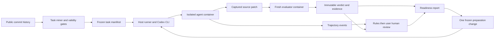

# Agent Readiness Probe design

Historical design snapshot, September 30, 2026, with later checkpoint appendices. Original scope and implementation assumptions below are superseded where explicitly amended by user approval. M3, M5 and M4 are now complete, and the public deliverables are ready for review. The historical checkpoints preserve what was known at each date, not current measurement status. Company-specific research and audit logs remain outside this public snapshot.

## Decision and product boundary

The probe answers a narrow question: for this repository snapshot, chosen agent, pinned model, and fixed resource limits, how often can an agent complete historical maintenance tasks, what observable failures occur, and does one preparation change improve performance?

Coding agent adoption workflows can include codebase preparation, governance, engineering-throughput measurement, and audits of existing rollouts. Assessment and continued measurement are overlapping capabilities, so pre-engagement timing alone does not establish a distinct contribution.

The proposed incremental artifact is a controlled historical-task replay with a frozen oracle, paired intervention outcomes, costs, and uncertainty. Its intended place is pre-engagement assessment. It can supply evidence to existing adoption workflows. Whether any particular organization already runs equivalent experiments is unknown. No production throughput dashboard, staffing metric, client monitoring, or replacement governance platform is planned.

Public Python repositories demonstrate the method. They do not measure a particular organization, its clients, or Devin. Repository-specific performance and agent-dependent failures in [P06](https://arxiv.org/html/2509.16941v1) and [P12](https://arxiv.org/html/2511.00197v1) motivate that boundary.

## Architecture

The host owns credentials, budget accounting, task selection, and evaluation artifacts. The agent sees only the buggy source, existing public tests and documentation, its task statement, and public dependency artifacts. Gold fixes and hidden tests never enter the agent container. The staged miner follows [P08](https://arxiv.org/html/2512.17419v1). Artifact separation follows the leakage analysis in [P07](https://arxiv.org/html/2609.08149v1).

## 1. Task miner

### Source selection

Start with [pallets/click](https://github.com/pallets/click), one small public Python repository. The target is 12 accepted tasks, with four development tasks and eight confirmation tasks. Inspect contributor documentation, CI, dependencies, test organization, and executable historical environments. A replacement is allowed only if Click history is insufficient, with the selection reason recorded. Do not expand to another active repository. M6 is optional future work and is not authorized.

Mine single-parent commits, including squashed PR fixes, that change production Python code and tests. Begin with bug fixes. Record feature or refactor candidates as out of scope for the first pilot rather than silently mixing task types. Reject merges with ambiguous parent selection, tests-only changes, dependency-only changes, generated code, and changes requiring credentials or external services. The initial cap is five production files and 300 changed production lines. These are tractability limits, not a literature-derived difficulty metric.

Fresh-task mining in [P03](https://arxiv.org/html/2505.20411v2) and executable collection in [P04](https://arxiv.org/html/2505.23419v1) motivate recording both the candidate population and the rejected cases.

### Reverting the fix without leaking it

For a commit C with parent B:

1. Split C minus B into the production patch, test patch, and other changes. Reject inseparable changes.
2. Reconstruct the buggy repository from B. This is equivalent to reverting C's fix from C without retaining its solution or future history.
3. Export a tracked-files-only source archive into the agent image. Create a fresh one-commit Git repository with no remotes, tags, original commit IDs, nested histories, stashes, or future objects.
4. Keep C's test delta, gold production patch, original history, and provenance in an evaluator-only store on the host.
5. Retain B's existing tests. Hide only newly added or changed oracle tests and their changed fixtures. Check ignored files, bytecode, installed package copies, image layers, and caches for solution artifacts before distribution.

This uses the test-breaking validation idea from [P01](https://arxiv.org/html/2504.21798v1) while keeping the historical base state. Future-object and hidden-artifact cleanup is justified by [P07](https://arxiv.org/html/2609.08149v1).

### Task statements

Write a concise problem statement from the pre-fix issue or PR requirements. Include reproducible inputs and expected behavior, without a solution, gold diff, exact fix location, or comments posted after the repair that reveal it. Save the source and sanitization decision separately from the agent-visible text. If no usable description exists, manually reconstruct the behavioral requirement and flag the description as reconstructed. Exclude ambiguous requirements that cannot be resolved without seeing the fix.

A human checks that every hidden assertion follows from the description or repository's existing public contract. Do not add gold-only requirements. Reject overly specific assertions or broaden them before freezing the dataset. [P05](https://arxiv.org/html/2602.23866v1) and [P07](https://arxiv.org/html/2609.08149v1) motivate explicit specification/oracle alignment checks.

### Validity gates

Validate in fresh Linux containers with a pinned Python version supported by B. The tool itself targets Python 3.11+. Keep one evaluator recipe and dependency set for all compared patch states.

| Gate | Required evidence |
|---|---|
| Buildable base | B installs and its supported base test suite passes in three fresh runs |
| Discriminating oracle | B plus hidden tests fails for the stated behavior in three fresh runs |
| Solvable task | B plus gold production patch plus hidden tests and the supported full suite passes in three fresh runs |
| Stable tests | Test selection, outcomes, and failure signatures are stable across those runs |
| Behavioral failure | Oracle failure is an assertion or expected behavioral mismatch, not missing infrastructure or a broken test import |
| Meaningful task | Human review rules out formatting, rote constant substitution, exact output-string trivia, and effectively supplied solutions |
| Clear specification | Reviewer maps requirements to assertions and checks alternate valid implementations are allowed |
| Exposure audit | Date/cutoff comparison, known benchmark duplicate checks, and solution-leak review recorded |

Small diffs can be nontrivial. Line count alone will not reject a valid task. A failing test alone will not establish validity. Wider test execution is motivated by [P16](https://arxiv.org/html/2503.15223v1). Version-specific environment validation is motivated by [P02](https://arxiv.org/html/2412.21139v2).

Freeze exactly 12 accepted tasks for the single repository if feasible. Reserve four for development and eight for confirmation. Use a disclosed purposive behavioral shortlist and fixed validation order. Assign the four/eight split using a fixed seed. Record observed bug-type and size categories without claiming a representative or stratified sample. Save counts at every filter and the exact sampling method. If fewer than 12 survive, report the actual count and pause the milestone for a decision. Do not weaken gates or create fictional tasks to reach the target.

Record contamination risk as `known_overlap`, `lower_known_risk`, or `unknown`. Exclude known benchmark overlap from the scored set. Prefer fixes published after the provider's documented training cutoff, not merely its reliable knowledge cutoff. Public availability still prevents a guarantee of no training exposure. Record dates for every task. If the selected model has no documented training cutoff or overlap audit is incomplete, mark exposure risk unknown. Historical tasks then form an exploratory pilot and cannot support a contamination-free performance claim. Known overlap remains excluded. A human must review the final task packet. Execution validation and assistant review are never labeled as completed human acceptance. [P03](https://arxiv.org/html/2505.20411v2) motivates temporal screening, not a claim of proof.

### Frozen task record

The manifest records task ID, public repo URL, license, B and C IDs in the private provenance record, source/archive hashes, task-statement hash, dates, task type, size, environment digest, lock/wheel hashes, setup and test commands, oracle IDs and hashes, validation artifacts, rejection history, manual validity review, sampling stratum, and exposure risk. Agent-visible IDs are opaque and carry no future SHA.

## 2. Agent adapter

Use a typed common interface with operations `prepare`, `run`, `cancel`, and `collect`. Inputs are an agent-visible task, a container handle, configuration, and remaining resource limits. Outputs contain an attempt status, captured patch, event stream, usage ledger, timestamps, and adapter/model versions. The runner owns evaluation. An adapter cannot return an authoritative success score.

M2 will implement a Codex CLI adapter behind this same interface. Use `codex exec --json` with the user's existing ChatGPT login. The CLI reuses saved authentication and emits structured events. [Official non-interactive documentation](https://developers.openai.com/codex/noninteractive) and [authentication documentation](https://developers.openai.com/codex/auth) distinguish ChatGPT subscription access from billed API-key access. Pin the CLI version and record the actual reported model and inference settings. No model is selected by assumption. A model change creates a new experiment version.

Require ChatGPT authentication before every batch. Strip API-key environment variables from the child environment and forbid API-key authentication, custom providers, paid tools, and purchased credits. Do not read, print, copy into the repository, or mount the user's credential store into a task workspace. M2 must verify a credential boundary and restricted OpenAI egress before live runs. A host-owned authenticated CLI transport with isolated task tools is a candidate implementation. Any inability to enforce that boundary blocks M2 rather than relaxing isolation.

Record usage counters only when returned by Codex. Preserve raw JSONL and parsing/version details. Missing counters are `not measured`. Dollar cost is always `not measured` because subscription usage does not provide a measured per-run dollar amount. Incremental paid API spend stays $0. Stop and tell the user if Codex usage limits block progress. Do not switch providers or buy capacity.

Provide a Devin adapter stub in M2 that raises an unsupported-adapter error without network activity. No Devin credentials or sessions are required. Codex outcomes cannot establish Devin performance.

## 3. Runner and resource control

### Isolation and environments

Each attempt uses its own Linux Docker container. It runs as a non-root user with two CPU cores, 3 GiB memory, a bounded process count, dropped capabilities, a read-only root filesystem, and bounded writable workspace/tmp storage. Use one concurrent task on this host initially. Containers receive no credentials, Docker socket, host home directory, or evaluator store. Task shell tools have no external network. Only the authenticated Codex transport may reach an explicitly verified OpenAI service endpoint allowlist. ChatGPT login can use OpenAI-owned ChatGPT endpoints rather than the billed API endpoint. Default-deny egress must block GitHub, PyPI, search, custom providers, and arbitrary destinations during agent work. CLI flags alone do not establish this boundary. Verify allow and deny probes in M2. The evaluator uses Docker `--network none` throughout execution, with no agent credentials or network proxy.

Build dependencies once from pinned public sources. Then run tasks offline with the same wheelhouse and system packages across arms. Image layers must contain only B's source and authorized dependencies. Never build an agent image from C's installed project package or full clone. Clean containers are motivated by [P04](https://arxiv.org/html/2505.23419v1). The hidden-artifact boundary is motivated by [P07](https://arxiv.org/html/2609.08149v1).

Declare an environment mode before selection:

- `ready`: the validated dependencies are installed, and both arms begin with the same developer-ready environment. This is the default initial experiment.
- `bootstrap`: the agent must install from a public offline wheelhouse using B's manifests and docs. This permits a setup-script intervention. Validation still uses a known working evaluator recipe. It is a distinct cold-start experiment and is reported separately.

Do not mix modes in a headline score. A setup failure in `ready` may be infrastructure error, while a task-specific wrong setup command in `bootstrap` can be an observed agent failure. Environment preparation must not pre-apply the intervention or remove the condition it is supposed to test.

### Time, money, and retries

Use a 15-minute agent wall-time limit, a 120-second shell-command limit, and a separate five-minute evaluator limit. Use one concurrent task. Enforce caps supported by the pinned CLI and record unavailable controls explicitly. Do not claim a per-request output or model-call cap unless the CLI can enforce it.

The incremental spending cap is $0. No paid API or paid judge is permitted. Stop and ask before any step that would require spending. Subscription usage is limited by the existing plan and is not a new cash allocation. No automated purchases, provider fallback, or paid retries are permitted. Usage-limit failures stop the experiment and are reported separately from task failures.

Plan 12 tasks * two arms * two attempts = 48 scored agent runs. M2's five smoke attempts use development tasks and count toward those 48 if the baseline configuration remains frozen. Up to two additional infrastructure retries bring the operational planning ceiling to about 50. Keep original aborted attempts in the audit. Never replace a completed poor result or select best-of-N. Optional Codex labeling would consume the same finite plan allowance and must be explicitly accounted for before adding calls.

### Logs and evaluation

Append JSONL events with run ID, task ID, arm, repeat, event sequence, time, command, working directory, visible output, exit status, model-visible messages, usage, and artifact hashes. Log only content the provider actually returns. Do not imply hidden model reasoning is available. Redact secrets at the host boundary and retain source hashes for audit. Record rate limits, transport errors, and cancellations explicitly. Trajectory diagnosis is motivated by [P12](https://arxiv.org/html/2511.00197v1).

At termination capture only allowed source changes. Reject path traversal, symlinks escaping the workspace, oracle edits, test deletion, evaluator configuration changes, and unauthorized setup modifications. Restore the immutable base tests and trusted harness in a fresh evaluator container. Apply the captured production patch and trusted intervention overlay, then inject hidden tests and run the supported full suite. The interactive agent never sees evaluator test output.

Disable automatic discovery of unapproved pytest plugins. Use a frozen plugin allowlist where required. Inspect suspicious passes for skipped assertions, broad monkeypatching, and test bypass. Docker plus these checks is a practical experimental boundary, not a complete defense against malicious evaluation code.

Keep task invalidity, runner infrastructure error, provider failure, budget/time truncation, test failure, invalid submission, and resolved status separate. A newly discovered invalid task is excluded from both arms, with its history retained and denominator changed visibly. [P07](https://arxiv.org/html/2609.08149v1) and [P16](https://arxiv.org/html/2503.15223v1) motivate clean evaluation and pass audits.

## 4. Failure classifier

The six requested failure classes are operational labels. They describe observable evidence and may coexist. They are not claims about hidden reasoning or proven causes. Add `unclassified` and `no_failure` rather than forcing every trace into one of the six classes.

| Label | Evidence needed | Important boundary |
|---|---|---|
| env_setup | Task-local dependency, build, path, or install failure prevents useful work | Docker daemon outage and provider outage are infrastructure, not repository evidence |
| missing_context | A required public contract/setup fact was available but absent from the agent's used context, supported by specific trace evidence | Vague uncertainty or a later successful rerun alone does not prove this cause |
| wrong_file_located | Trace shows work focused on an unrelated area and no credible route to the failing behavior | Gold-file mismatch alone is insufficient |
| convention_violation | A predeclared executable style/API constraint was violated | Undocumented reviewer preference is not an acceptance requirement |
| test_flakiness | Repeated unchanged patch/environment executions give inconsistent outcomes | A one-off assertion failure is not flakiness |
| reasoning_error | Observable implementation or algorithm error violates a clear requirement after relevant context and location are established | This is a behavioral shorthand, not access to internal reasoning |

Rules label high-evidence events first, such as install errors or a predeclared lint violation. The user's own human review follows the rules. No paid LLM judge is allowed. If an optional secondary label is useful, Codex headless may use the same ChatGPT login and budget policy. That optional stage reads a bounded, redacted evidence bundle for unresolved labels and produces structured labels, event references, uncertainty, and abstention. Blind model identity, arm, and aggregate score. Freeze prompt, model, schema, and parser versions. Refuse unsupported evidence references. [P06](https://arxiv.org/html/2509.16941v1) motivates trajectory buckets. [P12](https://arxiv.org/html/2511.00197v1) motivates separating localization from implementation. [P13](https://aclanthology.org/2026.acl-long.888.pdf), [P14](https://aclanthology.org/2026.findings-eacl.70.pdf), and [P15](https://aclanthology.org/2025.coling-main.7.pdf) motivate local calibration and secondary use of judges.

For M3 select 20 real trajectories, including failures where available and successful controls. The user supplies human labels and supporting evidence. Freeze rubric-development examples before sampling evaluation labels and keep them separate. Development trajectories support fix selection. Confirmation traces must remain sealed until the intervention is frozen. If the small pilot cannot supply 20 eligible independent evaluation examples, disclose reuse and effective sample size or pause for a scope decision.

Compare rules with the user's labels using exact agreement, per-class confusion counts, precision/recall where supported, primary-label kappa where defined, and abstention coverage. With one human reviewer, inter-human agreement is not measured. Preserve original labels and adjudication history. Assistant review is not human annotation. Do not claim independent double review that did not happen.

Freeze the candidate intervention from development evidence before M3 exposes any confirmation trajectories. The eight confirmation tasks supply only 16 baseline trajectories. To reach 20 reviewed trajectories, include four development trajectories held out from rubric development, and disclose their split and task clustering. Do not claim 20 independent confirmation examples. Those attempts count toward the final baseline batch. This keeps the later intervention estimate independent of fix selection. If confirmation evidence is used to revise the fix, a fresh confirmation set is required and the current one becomes development data.

Classes absent from the sample have agreement not measured. With fewer than 20 eligible trajectories or no human review, M3 remains incomplete. Do not fabricate failures to populate categories. Small samples and perturbation checks remain pilot validation. Test outcomes are never overruled by an LLM.

## 5. Readiness report and recommendations

Produce one single-file HTML report per repository, with inline CSS and optional inline JavaScript, no CDN, and escaped content. JSON/CSV sidecars remain the reproducible data source. A report with no runs says not measured. All display values carry source run IDs and manifest/configuration hashes.

The headline is a conditional test-verified success score:

`score = 100 * mean_over_tasks(mean_over_recorded_attempts(success))`

Each task has equal weight and the same planned repeat count. Success requires the hidden regression tests, supported full suite, and predeclared constraints to pass. Primary intent-to-attempt scoring counts task-local setup failures, caps, and submitted failures as unsuccessful. Runner/provider infrastructure failures are shown as missing outcomes and block a final comparable score until rerun or explicitly reported with best/worst-case bounds. Never drop them silently. Also show first-attempt success, execution coverage, and success conditional on a functioning environment.

There is no universal ready/not-ready threshold. Report agent, model, environment mode, task population, sampling method, eligible/accepted/excluded counts, and confidence intervals beside the score. Distinct agents or maturities do not share a causal readiness scale. Per-repository analysis follows [P06](https://arxiv.org/html/2509.16941v1). Small-sample caution follows [P11](https://arxiv.org/html/2607.27250v1).

Show primary failure counts as a partition with an explicit unclassified count. Show secondary labels separately, because their percentages can exceed 100%. Provide costs and runtime for all attempts, cost per verified success only if at least one succeeds, and task-level evidence links. Keep exact-match-to-gold scores out of acceptance, as motivated by [P12](https://arxiv.org/html/2511.00197v1) and [P16](https://arxiv.org/html/2503.15223v1).

### Top five fix candidates

Candidates are a pinned setup script, minimal executable context instructions, a maintained module/navigation map, documented convention examples with existing checks, and a focused deterministic test command or flaky-test repair. Select and rewrite them from actual failures. Do not force five recommendations if fewer are supported.

For a tested fix, expected per-attempt impact is its paired observed success delta, with an interval and measured cost tradeoff. For an untested fix, record supporting failures and their addressable share, but keep expected lift as not measured. That share is an opportunity bound, not a predicted rescue rate.

Order measured positive effects by conservative interval evidence, then list untested hypotheses by addressable failure share and effort. Clearly name the latter provisional priorities. With the approved one-intervention scope, a defensible empirical ranking of five expected lifts is unavailable. Testing all five would need another approved experiment. Do not fill that gap with invented conversion probabilities. Conflicting context effects in [P09](https://arxiv.org/html/2602.11988v1), [P10](https://arxiv.org/html/2601.20404v1), and [P11](https://arxiv.org/html/2607.27250v1) motivate this distinction.

## 6. Paired intervention and statistical plan

Before viewing confirmation outcomes, freeze one preparation change chosen from the four development tasks. It may add general contributor guidance, a navigation map, or an executable setup recipe. It must contain no task-specific solutions, future code, hidden tests, or gold-derived hints. Freeze the task manifest, baseline and intervention hashes, CLI/model/settings, environment mode, order randomization seed, outcome rules, and analysis script.

Run each of the eight confirmation tasks in both arms with two fresh attempts per arm. Pair by task and repeat index, randomize arm order, and preserve every observed attempt. Development results are exploratory and separate from the confirmation headline. Forty-eight runs across all 12 tasks do not create 48 independent task observations. Confirmation has eight task clusters and 32 runs.

Primary outcome is each task's mean hidden-test success across two attempts. Estimate intervention minus baseline using the mean of eight task differences. Report raw numerators and denominators, all task differences, and a paired task-cluster bootstrap 95% interval with 10,000 resamples and a fixed seed. Preserve both repeats and both arms within each cluster. Report first-attempt success with Wilson intervals and pass@2 as a secondary descriptive measure, without a selective best-patch headline.

This sample is small and intervals will be wide. Bootstrap intervals can be unstable or degenerate at eight tasks. Also report a conservative bounded-outcome interval using Hoeffding's bound for differences in [-1, 1], clipped to [-1, 1]. At n=8 its half-width is sqrt(2 * log(40) / 8), about 0.960. This is likely to be uninformative and makes the limited evidence explicit. Do not equate a null result with equivalence. Report negative estimates as possible regression and inconclusive intervals as inconclusive. [P11](https://arxiv.org/html/2607.27250v1) motivates explicit inference limits.

Time, visible token usage, missing usage, truncations, and infrastructure failures are secondary outcomes. Dollar cost is `not measured`. Include excluded invalid tasks and any denominator changes. If an oracle or validity rule changes after outcomes are seen, version the dataset and reevaluate both arms. Public historical tasks cannot establish performance on unseen enterprise work. No three-repository pooling or M6 run is part of this approved experiment.

## Milestones and release gates

Every milestone requires tests, a commit, a result summary, and explicit user approval before the next milestone. The latest user approval permits M2 after the accepted M1 freeze. It does not waive later gates.

| Milestone | Acceptance evidence |
|---|---|
| M1 | Miner on one public Python repo, 12 execution-validated task packets split 4/8, repeatable base/buggy/gold checks, rejection audit, pytest coverage of extraction and isolation, user task acceptance recorded for all 12 in m1-v7 |
| M2 | Codex CLI adapter and Devin stub, five real development smoke attempts counted in the 48-run plan, usage logs, cancellation and enforced egress/credential isolation checks |
| M3 | Rules and the user's own human review, 20 actual reviewed trajectories where supported, agreement metrics and disclosed coverage limits |
| M4 | One HTML report from real recorded attempts, aggregation and escaping checks, visible uncertainty and unresolved outcomes |
| M5 | One frozen fix, paired 8-task confirmation evaluation with two attempts per arm, intervals and honest null/regression handling |
| M6 | Optional future three-repository expansion. Not authorized and must not start |

Use typed Python 3.11+ code and pytest for core logic. Test risks such as patch splitting, path isolation, failed gold validation, flaky outcomes, zero-paid-API enforcement, label evidence references, denominators, and paired aggregation. Do not write tests that merely repeat implementation constants. Choose one documented reproduction command during M1/M2 and make it actually executable before describing it as a quickstart.

Phase 4 will run up to three audits of validity, evidence, statistics, adoption relevance, and duplication of existing capabilities. Audit logs and outreach remain in the private source repository. A literal proof that public tasks never entered proprietary model training is unavailable and must remain a disclosed limitation. Phase 5's findings, demo, reports, and real results table follow completed runs. Any outreach must lead with an actual measured result and will not be sent without a separate sending instruction.

## Current checkpoint

M1 now implements the offline miner, repeated historical checks, isolated base workspaces, and user review packet. The revised $0 plan remains in force. Execution validation and Swaroop's supplied acceptance are recorded separately. See [M1 results](m1_results.md) for observed counts and limitations. The partial Codex adapter has two infrastructure-aborted CLI invocations and no completed smoke outcome. No human failure labels, intervention effect, or outreach result exists yet. The accepted m1-v7 version is committed. M2 stopped on Docker task-operation timeouts and remains incomplete. Optional M6 must not start. Resources, current local limits, estimated full-experiment spend, and cheaper options are listed in [resource_checkpoint.md](resource_checkpoint.md).

The accepted pilot has revised statements aligned with hidden assertions before any agent run. These tickets are more precisely specified than typical real-world tickets. click-005 directly constrains _ansi_re, and development-only click-010 includes an unrelated duplicate-option warning check. Preserve these limitations in subsequent analysis.

## M2 stop record

October 1, 2026. The partial Codex adapter and boundary checks are implemented, but M2 is incomplete. Two CLI launches aborted without task-tool calls. The next container setup hit Docker exec and cleanup timeouts, triggering the requested stop. No smoke completed and no M2 evaluator ran. The later engine check responds and shows no remaining arp task container. Preserve all abort evidence and the two-infrastructure-abort ceiling. See [M2 status](m2_status.md). M3 and M6 have not started.

## Linux M2 checkpoint, October 1, 2026

The Windows implementation is superseded by the Linux agent/proxy architecture. All five development smokes passed after the network and native-tool gate passed. CLI 0.153.1 pins gpt-6-astra with low reasoning. Saved ChatGPT auth is mounted read-only and visible inside the ephemeral agent container, an accepted credential exception. Hidden tests, gold patches, private experiment artifacts, original history, and the Docker socket remain absent. Native CLI shell timeouts are not claimed as a separately enforced 120-second boundary. Retained diagnostic overhead requires reviewing the original approximate 50-invocation ceiling before completing the later 48-scored-run design. See [M2 status](m2_status.md). Stop for M2 review; no later milestone started.

## Current M4 checkpoint, October 2, 2026

The user approved the reduced twelve-label M3 scope and reordered M5 before M4. The frozen experiment is complete with 48 outcomes, retaining eight M3 baselines without reruns. Primary confirmation success delta is 0 pp; the degenerate cluster bootstrap triggers the Hoeffding 95% interval [-96.032, +96.032] pp, inconclusive. The [single-file M4 report](../reports/click_readiness.html) includes descriptive mechanism diagnostics, repeat consistency, the supplied human labels, the verified CliRunner aliasing trap and three evidence-supported fix priorities. Untested requirement-verification and convention-documentation candidates are marked not measured and require fresh held-out tasks. No new hypothesis tests or trajectories were generated. The treatment and labels remain frozen; stop for M4 review, with M6 and outreach unauthorized.
